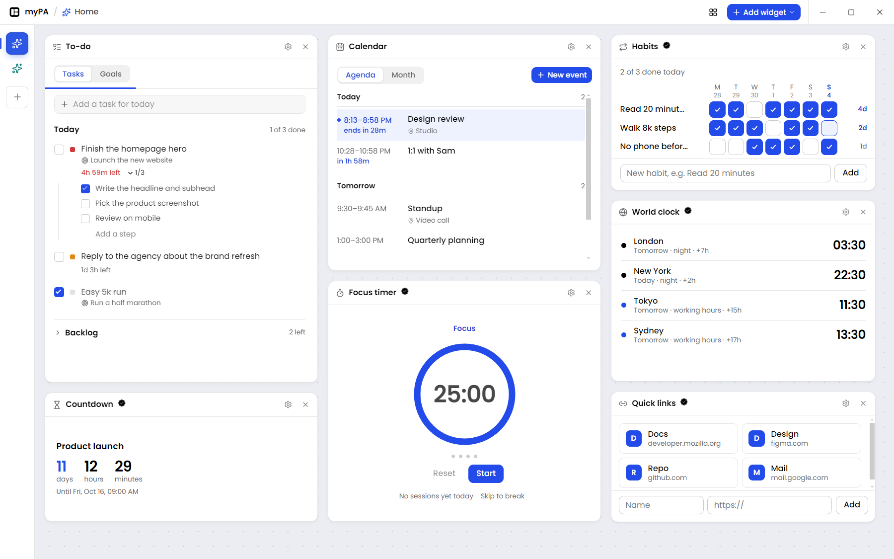
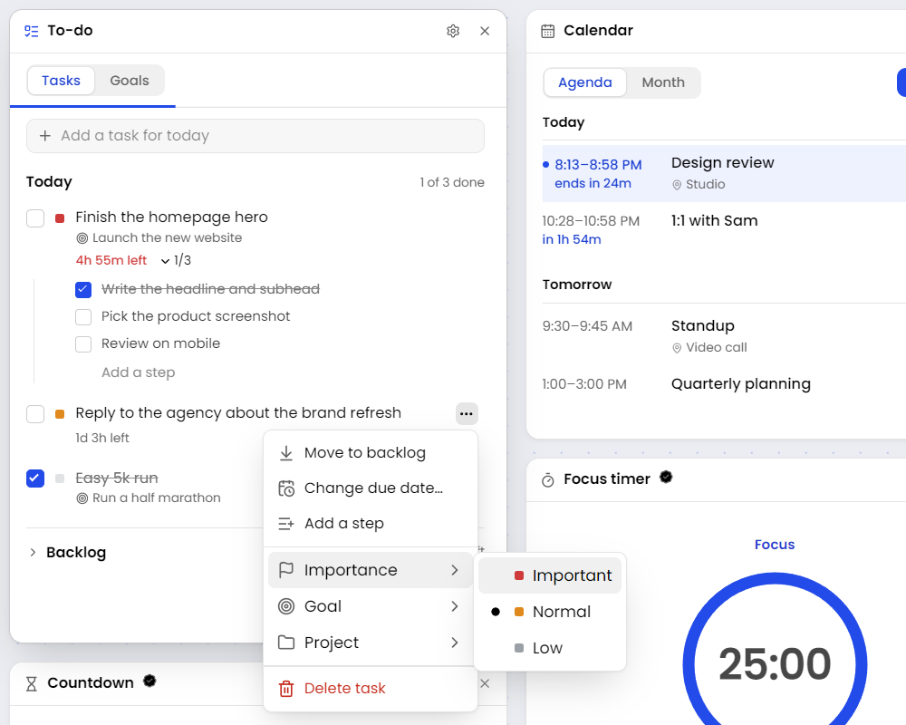
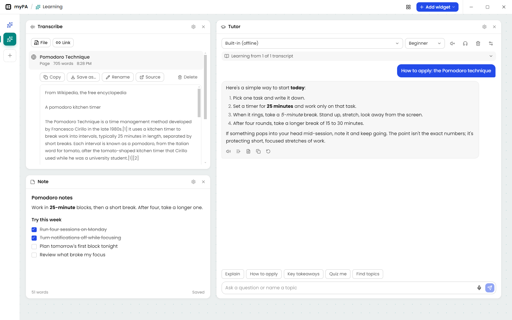
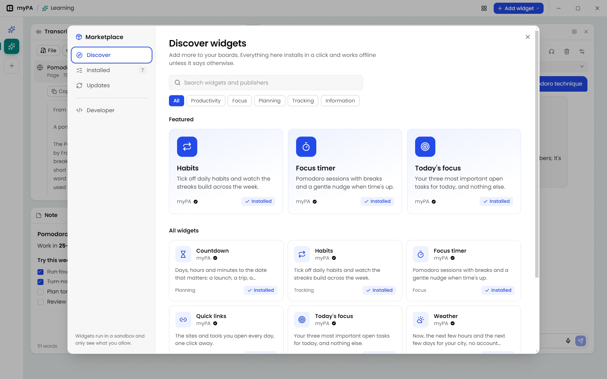
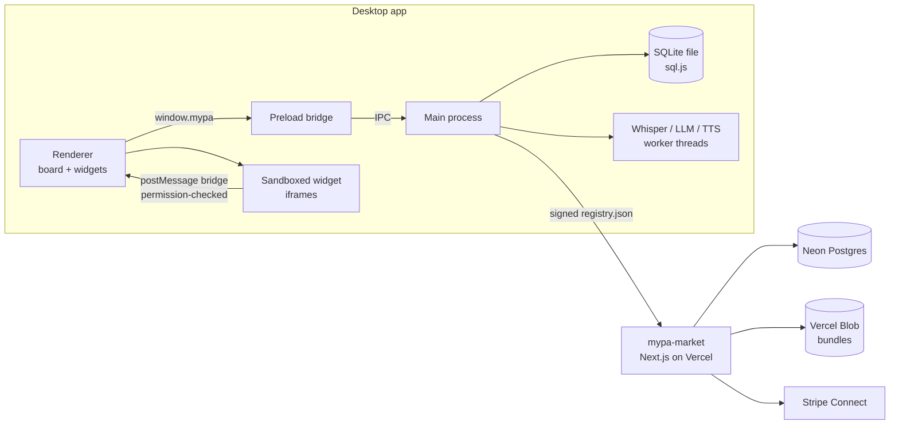

<h1 align="center">myPA</h1>

<p align="center">
  <strong>A personal command centre for your desktop.</strong><br />
  A board of widgets for your tasks, calendar, notes and learning that runs on your computer, works offline and keeps your data local.
</p>

<p align="center">
  
</p>

---

## What it is

myPA is a desktop app (Electron, Windows first) that you keep open all day. You fill **pages** (boards) with **widgets**, then drag them where you want and resize them. Each widget does one job well:

| Widget | What it does |
| --- | --- |
| **To-do** | Today and Backlog lists, goals with timelines, steps inside tasks, importance, due dates with live countdowns, drag between lists, and undo on every delete. |
| **Calendar** | Agenda and month views. Add your own events, or bring in Google, Outlook or any ICS feed (read-only, with your own OAuth app). |
| **Transcribe** | Turn audio and video files, media links (via `yt-dlp`) or web pages into searchable text. Transcription runs **on your computer** with Whisper. |
| **Tutor** | Learn from what you transcribed: explain, how to apply, key takeaways, quizzes. Uses a built-in **offline** model or a provider you configure. It can read answers aloud and listen to your questions. |
| **Note** | Markdown notes with tickable checklists. |
| **Marketplace widgets** | Focus timer, Habits, World clock, Weather, Countdown, Quick links, Today's focus, plus anything you build or install yourself. |

The goal: **the day's real work is visible, current and actionable at a glance, without leaving the app.**

<table>
  <tr>
    <td width="50%"></td>
    <td width="50%"></td>
  </tr>
  <tr>
    <td align="center"><sub>Every task can be edited in place. Its menu covers the rest.</sub></td>
    <td align="center"><sub>Transcribe a page, learn from it with the Tutor, keep notes. <br />(Article text from Wikipedia, CC BY-SA.)</sub></td>
  </tr>
</table>

<p align="center">
  
  <br /><sub>The in-app marketplace. Every widget runs in a sandbox and only sees what you allow.</sub>
</p>

## Principles

1. **Local first.** Your data is a SQLite file on your machine. Transcription and the offline Tutor run on-device. Nothing needs an account or a cloud service.
2. **Glanceable.** The state of your day reads in one look: what's next, what's late, what's done.
3. **Quiet by default.** The UI is monochrome, with one accent colour for interaction and "now". It only gets loud for things that matter, like priority or overdue work.
4. **Every widget behaves the same way.** Same chrome, same controls, same empty, loading and error states.
5. **Forgiving.** Destructive actions can be undone, and the app protects your data from crashes.

## Privacy: what leaves your computer

| Feature | Network use |
| --- | --- |
| Tasks, goals, notes, pages, local events | None. Stored in `%APPDATA%/mypa/mypa.db` with a rolling `mypa.db.bak`. |
| Transcribe | Downloads a Whisper model once (Hugging Face). Media links and web pages are fetched from their source. |
| Tutor (built-in) | Downloads the chosen model once (Qwen2.5 0.5B/1.5B or Phi-4 mini, via transformers.js). Answers are generated locally. |
| Tutor (provider) | Sends your question plus excerpts of the selected transcripts to the provider you configured (OpenAI-compatible or Anthropic). Keys are encrypted with the OS keychain (Electron `safeStorage`) and never reach the UI. |
| Calendar accounts | Read-only sync with the calendar you connect, using an OAuth app you own. |
| Marketplace widgets | Only the hosts listed in a widget's permissions (Weather → Open-Meteo, for example). Widgets have no other network access. |

## Getting started

**Requirements:** Node.js 24+, [pnpm](https://pnpm.io) 11, Windows 10/11. macOS and Linux should build, but aren't tested yet.

```sh
git clone <this repo> my-pa
cd my-pa
pnpm install

# run the desktop app with hot reload
pnpm --filter mypa dev
```

Optional, for media links in Transcribe: install [`yt-dlp`](https://github.com/yt-dlp/yt-dlp) (`winget install yt-dlp`). ffmpeg is bundled.

Build an installer:

```sh
pnpm --filter mypa package:dir   # unpacked app in apps/mypa/dist (fast)
pnpm --filter mypa package       # NSIS installer
```

The first launch seeds a short getting-started list. Your data lives in `%APPDATA%/mypa/`. To experiment without touching it, run with a separate profile:

```sh
pnpm --filter mypa build
cd apps/mypa && npx electron . --user-data-dir=../../.scratch/profile
```

## Repository layout

This is a [Turborepo](https://turborepo.com) monorepo managed with pnpm workspaces.

```
apps/
  mypa/            the desktop app (Electron + electron-vite + React 19)
    src/main/      main process: SQLite (sql.js), IPC, transcription, tutor, calendars, widget host
    src/preload/   the narrow bridge exposed to the UI as window.mypa
    src/renderer/  the board and the built-in widgets (React, Tailwind v4, shadcn/ui)
    src/shared/    types and IPC contracts shared by both sides
    widgets/       source of the official marketplace widgets
    resources/     icons and the signed built-in widget catalog
  market/          the hosted marketplace website (Next.js 16)
  docs/, web/      Next.js apps left over from the Turborepo template (see ROADMAP)
packages/
  design-system/   tokens and base styles shared by every app (black/white/#f2f2f2, Poppins, one accent)
  widget-sdk/      the widget contract, the mypa-widget CLI and the creator guide
  ui/              template React components used by docs/web
  eslint-config/, typescript-config/
docs/screenshots/  images used in this README
```

## How it works



- **One source of truth.** The main process owns the database. Every mutation goes over IPC and returns a fresh snapshot, which the UI renders.
- **Crash-safe storage.** Saves go to a temp file and are then swapped in. A backup of the last good database is kept, and a damaged file is set aside and restored from the backup instead of being overwritten.
- **Heavy work off the UI thread.** Transcription, the local LLM and text-to-speech run in Node worker threads, so the board stays responsive.
- **Widgets are untrusted.** Custom widgets are plain HTML/JS bundles served from a private `mypa-widget://` scheme into sandboxed iframes with a strict CSP. They reach the app only through the `mypa` SDK object. Every call is checked against the permissions the user approved (`tasks:read`, `tasks:write`, `calendar:read`, `notify`, `net:<host>`).
- **Signed catalogs.** Registries are ed25519-signed. The app ships its own official catalog and trusts the hosted marketplace's key, so a widget's trust mark (Official, Verified, Community, Unverified) is decided by signatures, not by what a registry claims. Paid widgets use offline license keys signed per publisher.

## Build a widget

A widget is a folder with a `manifest.json`, an `index.html` and whatever else it needs.

```sh
node packages/widget-sdk/bin/mypa-widget.ts init my-widget --id you.my-widget --name "My widget"
```

Then, in myPA, go to **Add widget → Browse the marketplace → Developer → Load unpacked folder**. The widget reloads on every save. When it's ready:

```sh
node packages/widget-sdk/bin/mypa-widget.ts validate my-widget
node packages/widget-sdk/bin/mypa-widget.ts pack my-widget     # → my-widget.mypawidget
```

Share the `.mypawidget` file, or publish it on the marketplace. The full guide, including the SDK API, permissions, settings fields and selling, is in [`packages/widget-sdk/README.md`](packages/widget-sdk/README.md).

## The hosted marketplace

`apps/market` is the public storefront at **[mypa-market.vercel.app](https://mypa-market.vercel.app)**:

- browse and install widgets, and read publisher pages
- a publisher dashboard for uploading new versions, pricing and Stripe payouts
- an admin review queue
- a signed `/registry.json` that the desktop app reads

It runs on Next.js 16 with Neon Postgres, Vercel Blob, Auth.js (GitHub sign-in) and Stripe Connect. To run it locally:

```sh
cp apps/market/.env.example apps/market/.env.local   # fill in values (or `vercel env pull`)
pnpm --filter market db:migrate
pnpm --filter market dev                             # http://localhost:3100
```

## Quality checks

Run these before every pull request:

```sh
pnpm check-types   # TypeScript across the monorepo
pnpm lint          # ESLint, zero warnings allowed
pnpm build         # every app builds
```

There is no automated test suite yet (see [ROADMAP](ROADMAP.md)). For now, every UI change is verified by running the app.

## Project status

myPA is an early, actively developed project (`0.1.0`). It is used daily on Windows. Things will change, including the database schema, though migrations keep existing data working.

- **Where it's going:** [ROADMAP.md](ROADMAP.md)
- **How to help:** [CONTRIBUTING.md](CONTRIBUTING.md)

## License

myPA is open source under two licenses:

| Part | License | What it means |
| --- | --- | --- |
| Everything in this repository by default: the desktop app (`apps/mypa`), the marketplace site (`apps/market`), the design system and the official widgets | [GNU AGPL-3.0](LICENSE) | Use, study, change and share it freely. If you distribute a modified version, or run a modified version as a network service (such as your own marketplace), you must publish your changes under the same license. |
| The widget SDK and CLI (`packages/widget-sdk`), its starter template, and the runtime the app serves to widgets (`sdk.js`, `theme.css`) | [MIT](packages/widget-sdk/LICENSE) | Build widgets however you like and license them however you like: open, closed, free or paid. |

The split is deliberate. The app and the marketplace stay open, and improvements flow back. Widget creators, including people selling widgets, are never forced to open their own code.

Packages taken unchanged from the Turborepo starter keep their original MIT license, as marked in their `package.json`.

### Name and logo

The licenses cover the code, not the brand. "myPA", the myPA logo and the "Official" trust mark identify this project. You're welcome to fork, but please give your fork a different name and icon, so people can tell them apart.
